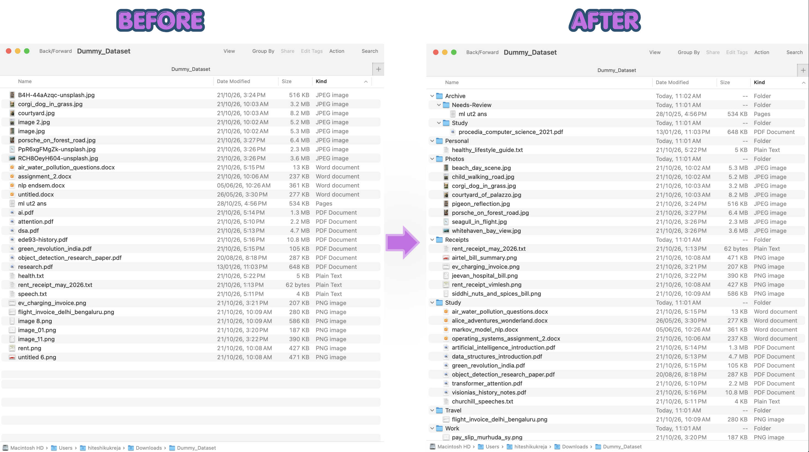
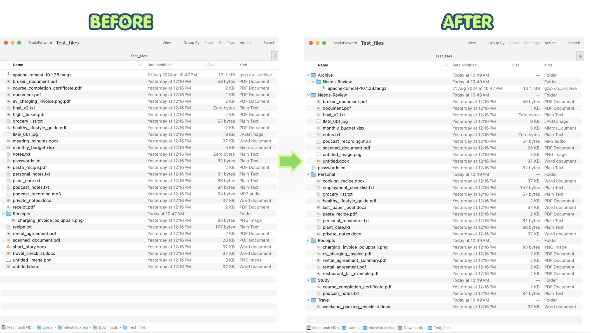

# File-Tidier

**A local AI file organizer that understands file contents, gives files meaningful names and sorts them without taking control away from you**

File-Tidier uses Gemma 3 4B through Ollama to organize messy folders on your own computer. Instead of relying only on filenames, it reads supported documents and images, proposes descriptive names and sorts files into Study, Personal, Receipts, Travel, Photos, Work, or Needs-Review.

It also supports **automatic age-based archiving:** choose an age threshold, such as six months and older files can be moved into Archive/ while preserving their category folders.

A generic image 8.png can become Receipts/rent_receipt_may_2026.png. A misleading filename does not have to dictate where a file goes. If a file cannot be read reliably, it can be routed to Needs-Review rather than treated as something the model understands.

**Preview the plan. Confirm the changes. Undo the run if needed.**

**No cloud AI API. No per-file charges. No server to maintain. And, after setup, no internet connection required.**

Built around the idea of Slow and Steady: automate the small, annoying tasks and get your time back.

Demo: [Watch the video](https://youtu.be/tXRiyng47rw) · Evaluation: [eval/EVAL.md](eval/EVAL.md)



## Run it

```
ollama pull gemma3:4b
git clone https://github.com/Kuki-09/file-tidier.git && cd file-tidier
python -m venv venv && source venv/bin/activate
python -m pip install -r requirements.txt

python cli.py run ~/Downloads/Messy                          # preview, then confirm
python cli.py run ~/Downloads/Messy --rename-only            # rename in place, no folders
python cli.py run ~/Downloads/Messy --archive-months 6       # old files go to Archive/
python cli.py undo ~/Downloads/Messy                         # reverse the last run
python watcher.py ~/Downloads/Messy                          # lazy mode, Ctrl+C to stop
```

Tested on a Mac with Python 3.10. The watcher handles only files that arrive after it starts. Tidy what is already there with one `cli.py run`.

## How it works

| Step           | What happens                                                                                                            | Code                            |
| -------------- | ----------------------------------------------------------------------------------------------------------------------- | ------------------------------- |
| Find files     | Top level only. Skips hidden files, partial downloads, symlinks and sensitive names (`.env`, keys, passwords, passport) | `scanner.py`                    |
| Read           | First 1,500 characters of a PDF, docx or text file. Images are shrunk to 896 px                                         | `extractor.py`, `classifier.py` |
| Name and sort  | Gemma 3 4B through Ollama, JSON checked with pydantic, one retry, then `Needs-Review`                                   | `classifier.py`                 |
| Keep or rename | The old name stays only if the model and a word-overlap check both say it is fine                                       | `planner.py`                    |
| Preview        | Numbered table filling in as each file finishes, then a confirm                                                         | `cli.py`                        |
| Move           | Never overwrites (`_2`, `_3` on a clash). Every folder it creates is logged                                             | `executor.py`                   |
| Undo           | Reverses the latest log and removes only the folders it created                                                         | `executor.py`                   |
| Lazy mode      | Waits until a file stops growing, then tidies only the new files                                                        | `watcher.py`                    |
| Archive        | Optional: files not modified for N months go to `Archive/<folder>`                                                      | `planner.py`                    |

## Safety

- Nothing leaves your machine. Everything runs through local Ollama.
- Preview first. Nothing moves until you confirm (the watcher has no confirm step, so it never creates folders or touches old files).
- Files are never overwritten. Name clashes get `_2`, `_3`.
- Full undo. Every run writes a log in `.tidy_logs/` inside the folder, with only paths in it.
- Files with sensitive names (`.env`, keys, passwords, passport and similar) are never read or moved.
- It stays in the folder you give it: top level only, no symlinks.

## Why open-source AI?

File-Tidier uses an **open-weight model** locally instead of relying on a closed, hosted AI service for every file.

**Offline use:** After setup and model download, file organization can run without Wi-Fi, provided the local model and required dependencies are available.

**Privacy:** File contents do not need to be uploaded to a third-party AI API.

**No per-file AI costs:** There are no usage-based API charges for classification. Your computer still uses electricity and local processing resources.

**No server to maintain:** Both the organizer and its optional watcher run on your own computer. The watcher does not require a separately hosted server.

**More control:** You can inspect the workflow, experiment with prompts and adapt or replace the model and supporting tools.

**Local AI has trade-offs:** inference can be slower on modest hardware and the model can still make mistakes. The benefit is greater control over your data, infrastructure and usage costs—not a guarantee of perfect results.

## Evaluation and Results

File-Tidier has been tested on a 30-file baseline set and a separate 26-file stress-test set.

**1.Baseline results**

**Correct destination category:** 30/30 files

**Same folder and filename across three runs:** 30/30 files

**Undo:** all 30 files restored byte-for-byte

The baseline answer key was prepared after earlier runs, so these results are a useful sanity check, not an independent benchmark. **Repeatability also does not prove correctness.**

**2.Stress testing**

The 26-file stress test included generic filenames, misleading extensions or names, already descriptive files, unreadable inputs and files that should be handled cautiously.

It exposed several useful failure patterns: some misleading filenames were correctly overridden using file content, while other cases showed that a plausible rename can still be wrong. It also highlighted the difficulty of distinguishing personal, study and work documents, as well as the need to handle blank images, scanned documents and unreadable files conservatively.

These findings informed improvements to the handling of unreadable inputs and the Needs-Review route. Results from runs before those changes should not be treated as measurements of the latest version. A fresh run of the same stress set is needed to measure the updated behavior fairly.

See [eval/EVAL.md](eval/EVAL.md) for the test setup, results and case-by-case analysis, mistakes and remaining limitations.

**Stress Test Output**



### Time Comparison

| Task                                    |    Time taken |
| --------------------------------------- | ------------: |
| File-Tidier: first pass over 30 files   | ~5 min 44 sec |
| Manual sorting: one person, one attempt | 10 min 49 sec |

In this trial, File-Tidier completed the first pass faster than sorting the same files manually. Results may vary depending on the files, system and manual sorting approach.

## Limits

- It cannot read `.pages`, `.mp3`, `.tar`, or scanned PDFs with no extractable text, so those are named from the file name alone.
- A small vision model can misread fine details in images (the year on a rent receipt changed between runs once). That is why undo exists.
- The watcher is a local convenience feature, not a cloud-hosted service. Your computer must remain running for it to monitor files.

## Data and licences

- Code: MIT (see `LICENSE`).
- Model: Gemma 3 under the Gemma Terms of Use, run locally through Ollama.
- Libraries: typer, rich, ollama, pypdf, python-docx, Pillow, pydantic and watchdog, each under its own licence.
